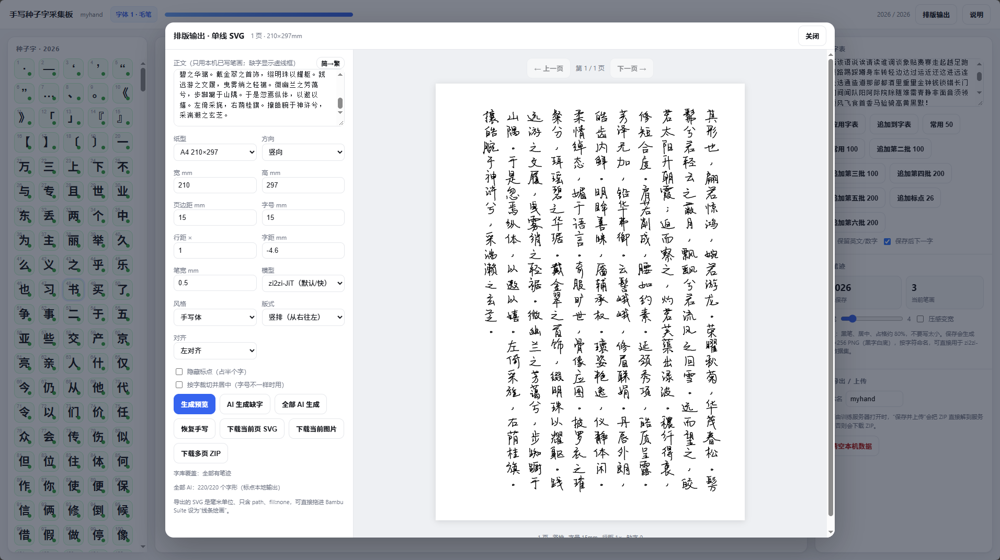
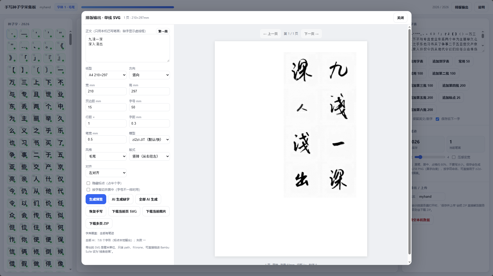
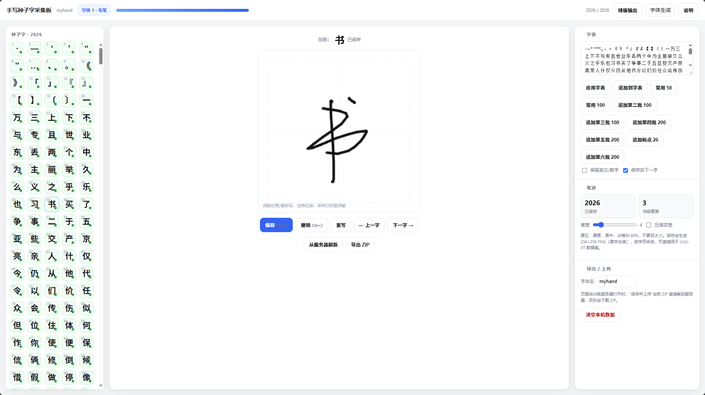
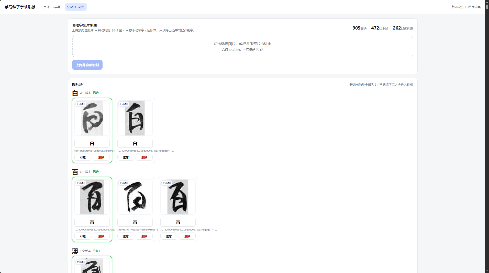

# Bambu Pen Studio

把**你自己的手写/毛笔字**变成可排版、可打印、可安装的字体工具集。

项目面向 Bambu Lab H2C 画笔模组与普通字体使用场景：

- 手写采集板：逐字书写、保存、导出训练数据
- 毛笔样本导入：上传照片、自动切块、人工标注
- 排版输出：单线 SVG、PNG、按页排版
- 字体生成：手写 TTF / 单线 SVG 包，毛笔 TTF
- 简繁字库：GB2312、Big5、简繁合一
- 逐字审核与重生成

> 本项目基于 **zi2zi-JiT** 做字体风格迁移。  
> 上游项目：<https://github.com/kaonashi-tyc/zi2zi-JiT>  
> 论文：**JiT: Just image Transformer**，<https://arxiv.org/abs/2511.13720>

## 截图

### 排版输出：长文本、单线路径



### 竖排与毛笔风格



### 单字编辑



### 毛笔样本导入



## 功能

### 1. 手写采集

- 2026 个常用字 + 26 个标点
- 256×256 画布，单线笔画
- 自动保存、撤销、上一字/下一字
- 导出 `strokes.json` 与 PNG
- 全局统一缩放，避免每个字大小不一致

### 2. 毛笔样本

- 支持一次上传多张照片
- 自动切块，默认全部标记为 `?`
- 在网页里人工输入对应汉字
- 只有标记并选中的样本会参与训练

### 3. 排版

- A4 / A5 / 自定义纸型
- 横排 / 竖排
- 字号、行距、字距、笔宽
- 手写体 / 毛笔体
- 简繁转换
- 隐藏标点（占半个字）
- 单字悬停重生成
- 下载当前页 SVG / PNG / 多页 ZIP

### 4. 字体生成

- 手写体：标准 TTF 或单线 SVG 包
- 毛笔：标准 TTF
- 字库：我的字库、GB2312、Big5、简繁合一
- 逐字保留 / 重生成
- 服务端批量任务：关闭浏览器后继续生成，重新打开自动接上进度

## 技术路线

```text
文字内容
  → 字形结构 / 单线笔画
  → 风格模型（手写 LoRA / 毛笔 LoRA）
  → 单线 SVG 或位图
  → 排版 / 字体构建
```

核心模型来自 **zi2zi-JiT**：

- **Content Encoder**：提取源字结构
- **Style Encoder**：提取目标字体风格
- **JiT 扩散 Transformer**：在像素空间生成字形

在本项目中：

- 手写模型：`font 0`
- 毛笔模型：`font 1`
- 字体生成使用**完整 LoRA checkpoint**，由推理脚本自动注入 LoRA
- 字体文件由 `fontgen_build.py` 用 FontTools 构建

## 训练方式

> 训练代码与基础模型不在本仓库内，请先获取上游 zi2zi-JiT 与对应基础权重。

### 数据准备

手写数据：

```text
data/user_glyphs/
  ├── 一.png
  ├── 万.png
  └── ...
```

每张图为 **256×256 白底黑字**，建议先归一化：

```bash
python scripts/normalize_glyphs.py \
  --src data/user_glyphs \
  --dst data/user2000_norm
```

毛笔数据按字体目录组织：

```text
data/font_dataset/train/
  └── 002_brush/
      ├── 一.png
      └── ...
```

### LoRA 微调

参考上游 `lora_single_gpu_finetune_jit.py`，本项目的实际配置：

```text
base model     JiT-B/16
LoRA rank      32
LoRA alpha     32
LoRA targets   qkv, proj, w12, w3
learning rate  6e-4（手写） / 8e-4（毛笔）
epochs         200
chars          2000（手写） / 262（毛笔）
```

示例命令（参数以上游脚本为准）：

```bash
python lora_single_gpu_finetune_jit.py \
  --base_checkpoint models/zi2zi-JiT-B-16.pth \
  --data_dir data/font_dataset \
  --lora_r 32 \
  --lora_alpha 32 \
  --lr 6e-4 \
  --epochs 200
```

训练完成后得到完整 LoRA checkpoint，推理时无需再单独挂载 2.2G 原始权重。

### 推理

```bash
python webapp/ai_worker.py
```

或由 `server.py` 自动拉起两个 worker：

- font0：手写
- font1：毛笔

## 运行方式

### 环境

```text
Python 3.11
CUDA GPU（建议 8GB 以上）
```

```bash
python -m venv .venv
source .venv/bin/activate
pip install -r requirements.txt
```

### 启动 Web 服务

```bash
export HW_DATA_DIR=$PWD/data/user_glyphs
export HW_UPLOAD_DIR=$PWD/data/uploads
export PORT=8088
python webapp/server.py
```

打开：

```text
http://127.0.0.1:8088/            手写采集板
http://127.0.0.1:8088/font1.html  毛笔样本导入
http://127.0.0.1:8088/fontgen.html 字体生成
```

### 目录

```text
webapp/
  index.html          手写采集 + 排版
  font1.html          毛笔样本导入
  fontgen.html        字体生成
  server.py           静态服务 + API
  ai_worker.py        zi2zi-JiT 常驻推理
  fontgen_build.py    TTF / 单线 SVG 构建
scripts/
  normalize_glyphs.py 训练数据归一化
model_lab/scripts/
  render_glyphs.py    字形预览
```

## 隐私与数据

本仓库**不包含**：

- 作者本人的手写/毛笔字形图片
- 训练得到的模型权重
- 个人训练数据、字体文件、上传照片
- 任何 API Key、账号、Token

`.gitignore` 已排除：

```text
data/
fontai_out/
model_lab/inputs/
model_lab/ckpt/
webapp/fontgen_out/
*.pth
*.ttf
*.otf
```

README 中的截图仅用于功能演示，截图内容由项目作者提供并授权使用。

## 开源与署名

本项目代码使用 **MIT License**。

基于 **zi2zi-JiT** 的推理与训练流程，遵循上游 **MIT License** 与 **Font Artifact License Addendum**：

> Created using zi2zi-JiT artifacts  
> <https://github.com/kaonashi-tyc/zi2zi-JiT>

若你使用本项目生成并分发超过 200 个字符的字体，请在上游要求的位置保留上述署名与链接。

详细条款见 [NOTICE.md](NOTICE.md)。

## 贡献

欢迎提交 Issue / PR。请先阅读 [CONTRIBUTING.md](CONTRIBUTING.md)。

## 致谢

- [zi2zi-JiT](https://github.com/kaonashi-tyc/zi2zi-JiT)
- [JiT: Just image Transformer](https://arxiv.org/abs/2511.13720)
- [FontDiffuser](https://arxiv.org/abs/2312.12142)（Content Encoder 参考）
- [FontTools](https://github.com/fonttools/fonttools)
- [OpenCC](https://github.com/BYVoid/OpenCC)

---

**Bambu Pen Studio** · 让每个人都能留下自己的字。
